<div align="center">

# 🚀 Space Museum · متحف الفضاء

**Walk among the machines humans left on the Moon and Mars. Hear their stories. Play their missions.**

**امشِ بين الآلات التي تركها البشر على القمر والمريخ، واسمع قصصها، والعب مهماتها.**

Team **ARASYN** · NASA Space Apps Challenge 2026 · Karak, Jordan
Challenge: *Discarded Equipment Storytelling*

### [▶ Open the museum](https://7arb06.github.io/space-museum/) · [📊 Slides (PDF)](space-museum-pitch.pdf) · [العربية ⬇](#العربية)

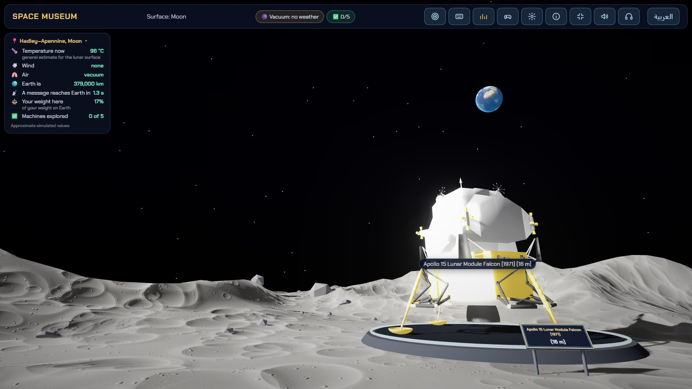

</div>

---

## The problem

The machines people left on the Moon and Mars carry some of the best stories in space exploration. But those stories sit on technical pages, mostly in English, and are rarely made for children, for blind or deaf visitors, or for Arabic readers. To most people, a lander left on Mars is just a piece of junk.

## Our answer

A **3D museum in the browser**. You board a spaceship, fly to the Moon or Mars, step out, and walk among five real machines. Each one tells its own story, answers your questions, and shows what it could mean for people who live there one day.

- 🌍 **Arabic and English**, everywhere.
- ♿ **Designed for everyone from day one:** blind, deaf, limited movement, dyslexia, children, and people sensitive to flashing.
- 📡 **Every fact comes from NASA**, with the source under each answer.
- 🔌 **Works with no internet:** one file, no install, no server.

---

## A tour in pictures

| | |
|:---:|:---:|
| 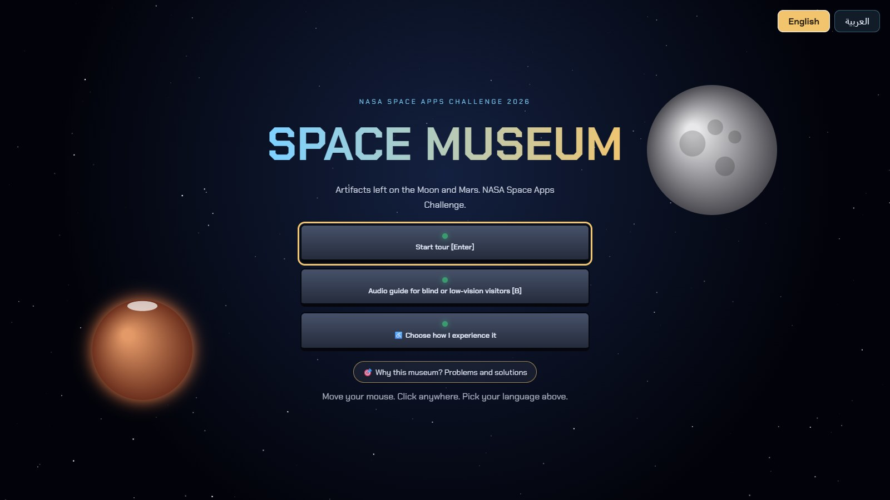 | 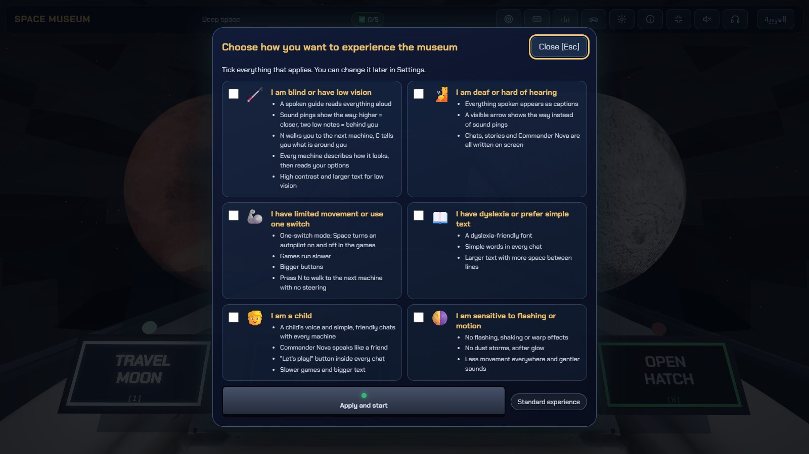 |
| **Start screen:** choose your language | **Choose how you experience it:** six profiles |
| 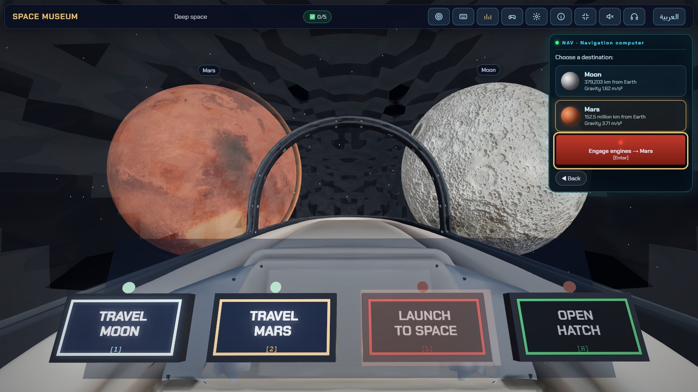 | 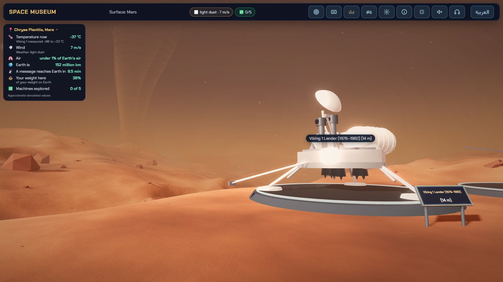 |
| **Navigation computer:** today's real distance and gravity | **Mars:** light dust, a dust devil, live data panel |
| 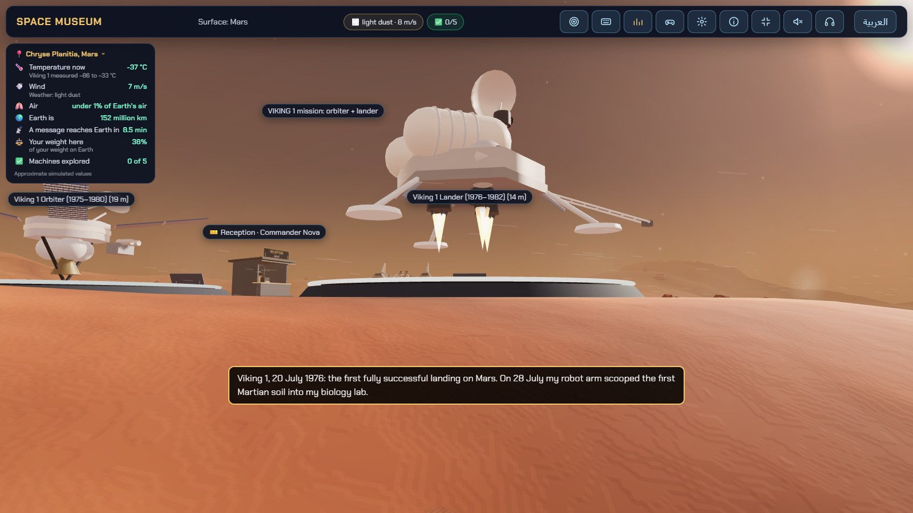 | 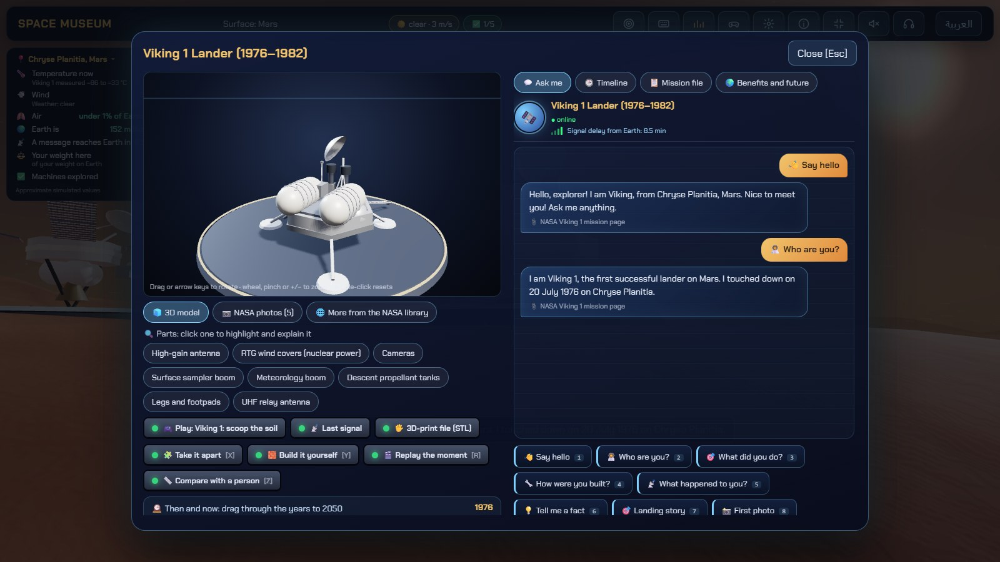 |
| **Replay the moment:** Viking 1 lands, 20 July 1976 | **Talk to the machine:** answers with their NASA source |
| 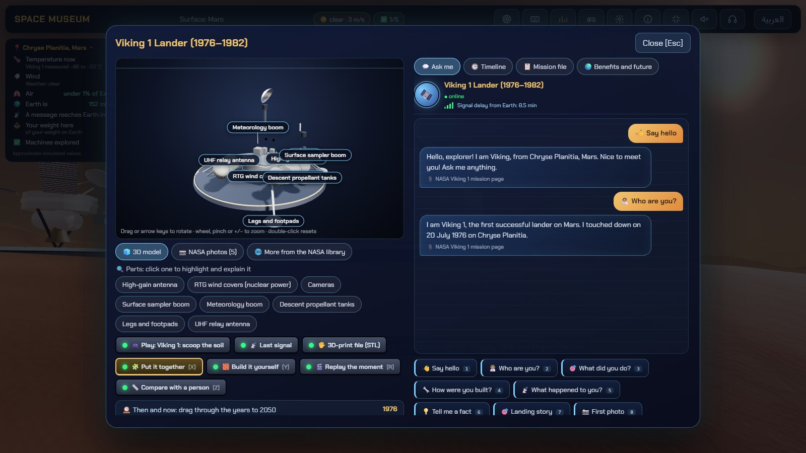 | 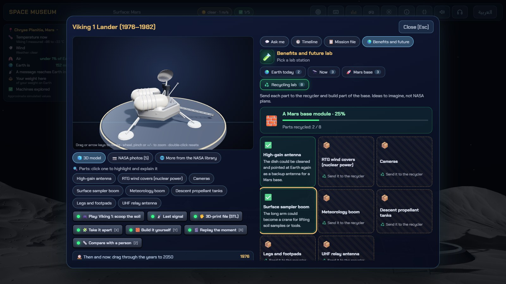 |
| **Take it apart:** every part labelled and explained | **Recycling lab:** turn each part into a future base |
| 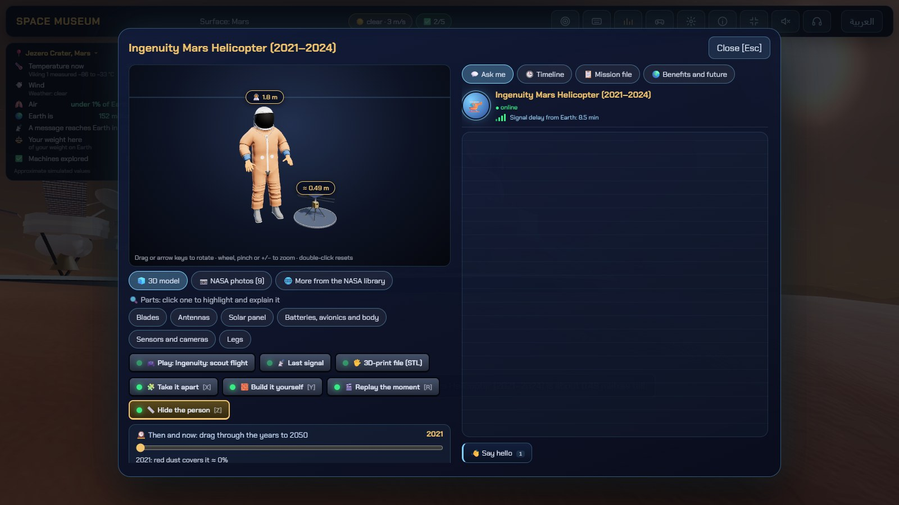 | 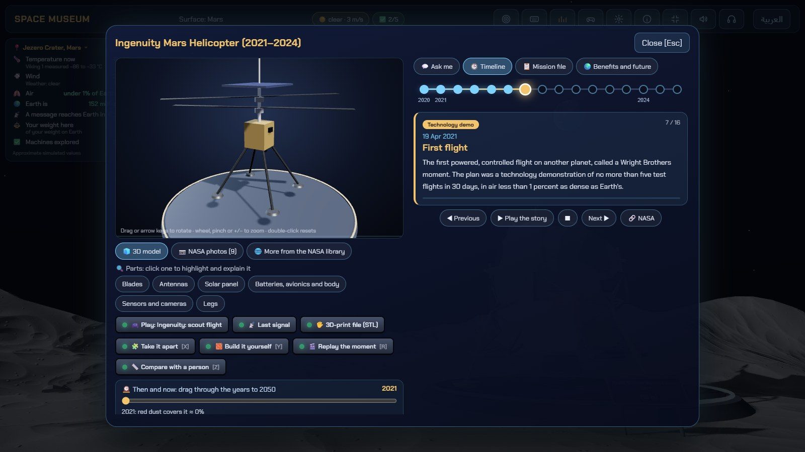 |
| **Real size:** Ingenuity next to a 1.8 m astronaut | **Spoken timeline:** the model changes at every stop |
| 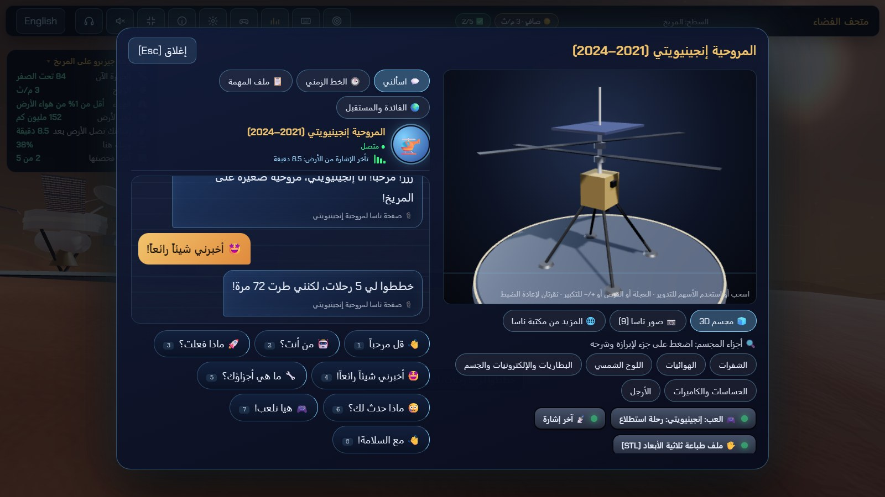 | 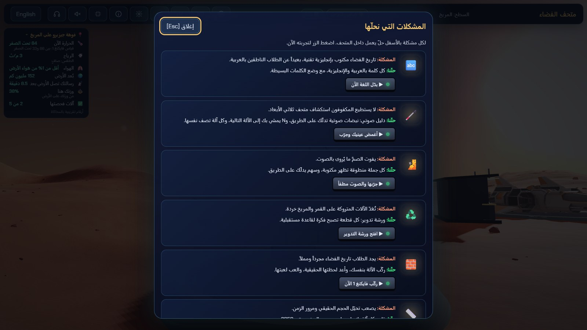 |
| **Kids mode:** simple, friendly chats and a child's voice | **Problems we solve:** each with a "try it now" button |

<div align="center">


**Eyes-closed mode:** explore by sound alone, the way a blind visitor does.

</div>

---

## The five machines

| Machine | Where | Years | Its moment in the museum |
|---|---|---|---|
| **Surveyor 3** | Moon, Oceanus Procellarum | 1967 | Lands and bounces twice, as it really did |
| **Apollo 15 Lunar Module *Falcon*** | Moon, Hadley–Apennine | 1971 | The ascent stage lifts off, the descent stage stays |
| **Viking 1 Lander** | Mars, Chryse Planitia | 1976–1982 | Lands on three engines, then scoops the first soil |
| **Viking 1 Orbiter** | Mars orbit | 1975–1980 | Rises and maps Mars |
| **Ingenuity Mars Helicopter** | Mars, Jezero Crater | 2021–2024 | Spins up and flies a loop |

## What you can do with every machine

| | |
|---|---|
| 💬 **Ask it questions** | A chat where the machine answers in its own voice, with the NASA source under every answer |
| 🎬 **Replay the moment** `R` | The machine acts out its real moment, right there on the surface |
| 🧩 **Take it apart** `X` | Parts slide out with labels; click one to hear what it did |
| 🧱 **Build it yourself** `Y` | Put it back together from the bottom up, with hints when you are wrong |
| 🔊 **A sound for every part** | Antenna beeps, rotor whirr, engine rumble, camera shutter… |
| 🕒 **Spoken timeline** | Up to 16 stops; the 3D model changes at each one |
| 🕰️ **Then and now** | Drag through the years to 2050 and watch dust settle on it |
| 📏 **Compare with a person** `Z` | A 1.8 m astronaut next to the machine, at real scale |
| 🧪 **Benefits and future lab** | How it helps Earth today, how scientists use it, and how it would help a Moon or Mars base |
| ♻️ **Recycling lab** | Send each part to the recycler and build a base module |
| 🎮 **A game** | A short game based on its real mission (5 games in total) |
| 📋 **Mission file** | The key numbers and dates, with sources |

## The journey

- **Navigation computer:** plan a trip and pick a destination. It shows today's real distance, worked out from planetary orbits, plus the gravity, live speed, distance left, and how long the real mission took.
- **Real physics:** the Moon landing is calm (no air). Mars shakes through atmospheric entry, then deploys a parachute and fires retro-rockets. Jump with real Moon (1.62 m/s²) and Mars (3.71 m/s²) gravity.
- **On the surface:** walk down the ramp and leave footprints (they stay on the Moon, fade on Mars). Weather changes on Mars, from clear skies to dust storms and dust devils. The panel shows the temperature, how long a message takes to reach Earth, and your weight there; these are approximate simulated values and are labelled that way.
- **Commander Nova** at reception: a guided tour, a visitor pass, and a time capsule.

## Made for everyone: «Choose how you experience it»

| Profile | What changes |
|---|---|
| 🦯 **Blind or low vision** | Spoken guide; sound pings show the way (higher = closer, two low notes = behind you); `N` walks you to the next machine; `C` tells you what is around; every machine describes itself; high contrast |
| 🧏 **Deaf or hard of hearing** | Every spoken line appears as text; a visible arrow replaces the sound pings |
| 🦾 **Limited movement** | One-switch play (autopilot in games); slower games; bigger buttons; `N` to walk with no steering |
| 📖 **Dyslexia** | Dyslexia-friendly font, simpler words, larger text |
| 🧒 **Child** | A child's voice, simple friendly chats with every machine, a "Let's play!" button |
| 🌗 **Sensitive to flashing or motion** | No flashing, shaking or dust storms; less motion everywhere |

Also included: full keyboard control, focus that stays inside open windows, captions, high contrast, reduced motion and larger text.

## Who benefits

- **NASA:** its mission stories reach audiences it rarely reaches (Arabic speakers, people with disabilities, children). The museum is also a template: adding another machine means adding data, not rebuilding.
- **Everyone:** free, in the browser, nothing to install, works offline, in two languages.
- **School students:** physics by doing, history through spoken timelines, engineering and sustainability by taking machines apart and recycling them. It runs on any school computer, even with no internet.

---

## Run it

- **Online:** <https://7arb06.github.io/space-museum/>
- **Offline:** download [`index.html`](index.html) (about 59 MB) and double-click it. Everything is inside the file: the 3D engine, models, photos, fonts and more than 700 recorded voice clips.
- **Best in Microsoft Edge or Chrome** on a computer. Edge has Arabic system voices for lines that have no recording.

### Keys

| Key | Action |
|---|---|
| `W A S D` / arrows | Walk (`Shift` to run) |
| `Space` / `J` | Jump |
| `E` | Inspect a machine, talk to Nova, enter the ship |
| `R` | Replay the nearest machine's moment |
| `N` | Walk to the next machine you have not seen |
| `C` | Compass: where you face and what is around |
| `F` | Describe the nearest machine |
| `B` | Audio guide with direction pings |
| `X` / `Y` / `Z` | In a machine window: take apart / build / compare with a person |
| `1`–`9` | Pick a question (or a part while building) |
| `1` / `2`, `L`, `H` | Cockpit: fly to the Moon / Mars, launch, open the hatch |
| `M` / `P` | Sound on or off / pause speech |
| `/` | All keyboard shortcuts |
| `Esc` | Close a window or free the mouse (hold it to leave full screen) |

---

## How it is built

- **three.js r128 (WebGL)** for 3D in the browser, with GLB/Draco models, bloom post-processing and a quality setting that lowers itself on slow devices.
- **Web Audio** for direction pings, footsteps, wind and part sounds.
- **One self-contained HTML file:** libraries, fonts, models, photos and voices are embedded, so it works offline.
- **Tested:** an automated pass clicked every button in every window, for all five machines, in both languages and six display modes, with no errors. We measured smoothness too: the first frame on arriving at Mars went from 2.9 s to about 34 ms, and opening a machine window takes 10–40 ms.

### Source code (`source/`)

| File | What it is |
|---|---|
| `src.html` | The museum's core: worlds, machines, chat, timelines, games, accessibility |
| `v4.css`, `v4.js` | Terrain, weather, audio guide, keyboard navigation, 3D viewer |
| `v5.js` | Take apart, build it yourself, part sounds, replay the moment, then and now, size comparison |
| `v6.js` | Navigation computer, landing physics, hatch walk, chat look, future lab |
| `v7.js` | Offline libraries, post-processing, stutter fixes, experience profiles, kids mode, problems and solutions |
| `lib/` | three.js and its loaders, the Draco decoder, fonts |
| `build.mjs` | Joins everything into `index.html` |
| `tools/extract-data.mjs` | Recreates `data/` (models, photos, voices) from the published `index.html` |

Rebuild it yourself (needs [Node.js](https://nodejs.org)):

```bash
cd source
node tools/extract-data.mjs ../index.html
node build.mjs
node serve.mjs
```

Then open <http://localhost:5178>. The rebuilt `index.html` is identical to the published one.

**Add a machine:** describe it in the data (name, place, dates, parts, timeline, questions) and give it a 3D model. Nothing else needs to change.

---

## Sources, credits and AI use

- **Facts:** NASA mission pages (Viking 1, *Viking: 50 Years on Mars*, Ingenuity and its articles, Surveyor 3) and the NASA NSSDCA catalogue for Apollo 15. The source is shown under every answer in the museum.
- **Photos:** the NASA pages above and the NASA Image and Video Library. With an internet connection, "More from the NASA library" fetches photos from it live.
- **Labels we use:** ideas about the future and recycling are marked *"an idea to imagine, not a NASA plan"*. Live temperature and distance are marked *"approximate simulated values"*.
- **Models and textures** (spaceship, cockpit, Moon, Mars, Earth, astronaut suit, Apollo lunar module): supplied by the team.
- **Open-source software:** [three.js](https://threejs.org) (MIT), [Draco](https://google.github.io/draco/) decoder (Apache 2.0), fonts Chakra Petch and Lexend (SIL Open Font License).
- **AI use:** the code was written with the help of an AI assistant (Claude by Anthropic). The recorded voices were generated with AI (ElevenLabs).

---

<div dir="rtl" align="right">

<h2 id="العربية">العربية</h2>

### المشكلة
الآلات التي تركها البشر على القمر والمريخ تحمل بعضاً من أجمل قصص استكشاف الفضاء، لكن قصصها موجودة في صفحات تقنية، وغالباً بالإنجليزية، ونادراً ما تُصمَّم للأطفال أو للمكفوفين أو للصم أو لقرّاء العربية. وبالنسبة لمعظم الناس، تبدو مركبة متروكة على المريخ مجرد خردة.

### حلّنا
**متحف فضاء ثلاثي الأبعاد** يعمل في المتصفح: تركب مركبة فضائية، وتسافر إلى القمر أو المريخ، وتنزل وتمشي بين خمس آلات حقيقية. كل آلة تحكي قصتها، وتجيب عن أسئلتك، وتُريك ماذا يمكن أن تعني لمن يعيش هناك يوماً ما.

- 🌍 **بالعربية والإنجليزية** في كل مكان.
- ♿ **مصمم للجميع من البداية:** المكفوفون والصم ومحدودو الحركة وأصحاب عُسر القراءة والأطفال والحساسون للوميض.
- 📡 **كل معلومة من ناسا**، ومصدرها مكتوب تحت كل جواب.
- 🔌 **يعمل بدون إنترنت:** ملف واحد، بلا تثبيت، وبلا سيرفر.

### الآلات الخمس
سيرفيور 3 (القمر، 1967) · المركبة القمرية فالكون من أبولو 15 (القمر، 1971) · مركبة فايكنغ 1 الهابطة (المريخ، 1976–1982) · مدارية فايكنغ 1 (مدار المريخ، 1975–1980) · مروحية إنجينيويتي (المريخ، 2021–2024).

### مع كل آلة تستطيع أن
- 💬 **تسألها:** تجيبك بلسانها، وتحت كل جواب مصدره من ناسا.
- 🎬 **تعيد لحظتها** (`R`): تمثّل الآلة لحظتها الحقيقية على السطح.
- 🧩 **تفكّكها** (`X`) و🧱 **تركّبها بنفسك** (`Y`)، و🔊 لكل قطعة صوتها.
- 🕒 **تسمع خطها الزمني**: يتغيّر المجسم مع كل محطة.
- 🕰️ **ترى أمس واليوم**: اسحب السنين حتى 2050 وشاهد الغبار يستقر عليها.
- 📏 **تقارنها بحجم إنسان** (`Z`) بالمقياس الحقيقي.
- 🧪 **تدخل مختبر الفائدة والمستقبل** و♻️ **ورشة التدوير**: كل قطعة تصبح فكرة لقاعدة مستقبلية.
- 🎮 **تلعب لعبتها**: لعبة قصيرة مبنية على مهمتها الحقيقية.

### الرحلة
حاسوب ملاحة يحسب المسافة الحقيقية اليوم ويعرض الجاذبية والسرعة ومدة الرحلة الحقيقية. الهبوط على القمر هادئ لأنه لا هواء هناك، وعلى المريخ يهتز مع دخول الغلاف الجوي ثم تُفتح المظلة. بعدها تنزل على المنحدر، وتترك آثار أقدامك، وتشاهد طقس المريخ يتغيّر، ويستقبلك القائد نوفا في كشك الاستقبال.

### «خصّص تجربتك»
| الخيار | ماذا يتغيّر |
|---|---|
| 🦯 **كفيف أو ضعيف البصر** | دليل صوتي، ونبضات تدلّك على الطريق، وN يمشي بك، وC يخبرك بما حولك |
| 🧏 **أصم أو ضعيف السمع** | كل الكلام مكتوب، وسهم بدل الأصوات |
| 🦾 **حركة محدودة** | اللعب بزر واحد، وألعاب أبطأ، وأزرار أكبر |
| 📖 **عُسر القراءة** | خط خاص وكلمات أبسط ونص أكبر |
| 🧒 **طفل** | صوت طفل ومحادثات بسيطة وزر «هيا نلعب!» |
| 🌗 **حساس للوميض** | بلا وميض ولا اهتزاز ولا عواصف |

### من يستفيد
- **ناسا:** تصل قصص مهماتها لجمهور جديد، وإضافة آلة جديدة مجرد بيانات.
- **الناس:** متحف مجاني بلغتين ولكل القدرات، ويعمل بلا إنترنت.
- **طلاب المدارس:** فيزياء وتاريخ وهندسة واستدامة بالتجربة، على أي حاسوب في المدرسة.

### التشغيل
- **أونلاين:** <https://7arb06.github.io/space-museum/>
- **بدون إنترنت:** نزّل `index.html` وافتحه بنقرتين.
- **الأفضل:** متصفح Microsoft Edge أو Chrome على الحاسوب.

### المصادر واستخدام الذكاء الاصطناعي
المعلومات من صفحات مهام ناسا وقاعدة NSSDCA، والصور من صفحات ناسا ومكتبة NASA Image and Video Library. الأفكار المستقبلية موسومة بأنها للتخيّل وليست خطط ناسا، والقيم الحية موسومة بأنها تقريبية. كُتب الكود بمساعدة مساعد ذكاء اصطناعي (Claude من Anthropic)، والأصوات المسجّلة مولّدة بالذكاء الاصطناعي (ElevenLabs).

</div>
